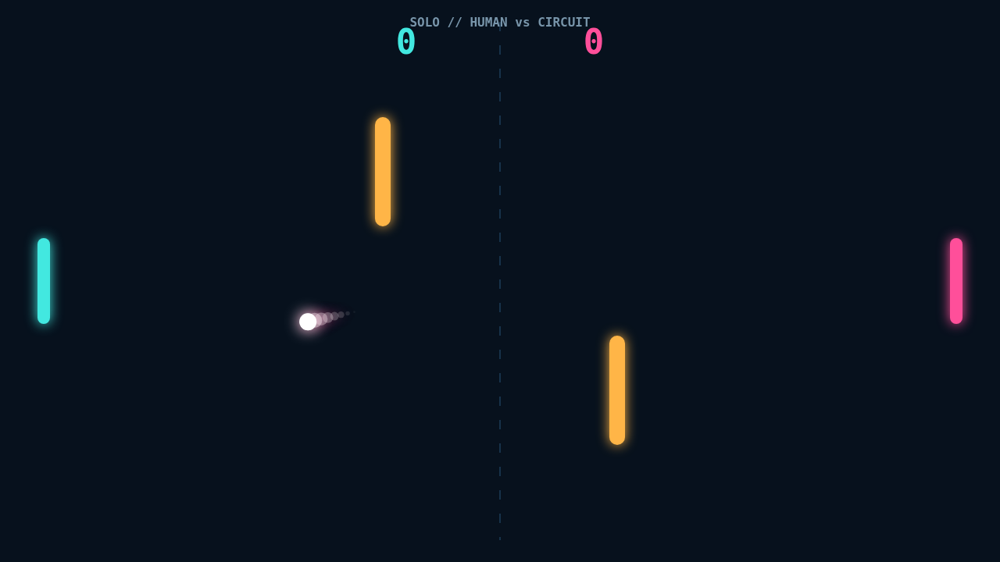

# Carom

Carom turns the familiar paddle duel into a bank-shot contest. Two bright paddles face off across a midnight court while a pair of amber bars breaks every obvious line to the goal.

A match opens with a short hold, then the ball snaps toward the receiving side. Each return accelerates the rally. Reach 11 first with a two-point lead, but expect deuce rallies to become wonderfully tense.

Movement at the instant of contact feeds spin into the ball. Slide downward through a hit and its path curls clockwise; climb into it and the curve reverses. The luminous trail makes that changing arc readable as it develops.

The obstacles are opportunities, not clutter. Clip their faces to change lanes, bend a shot around one, or assemble a ricochet your opponent cannot read in time. Solo pits you against a reactive circuit defender, while Versus puts both paddles on one keyboard.

